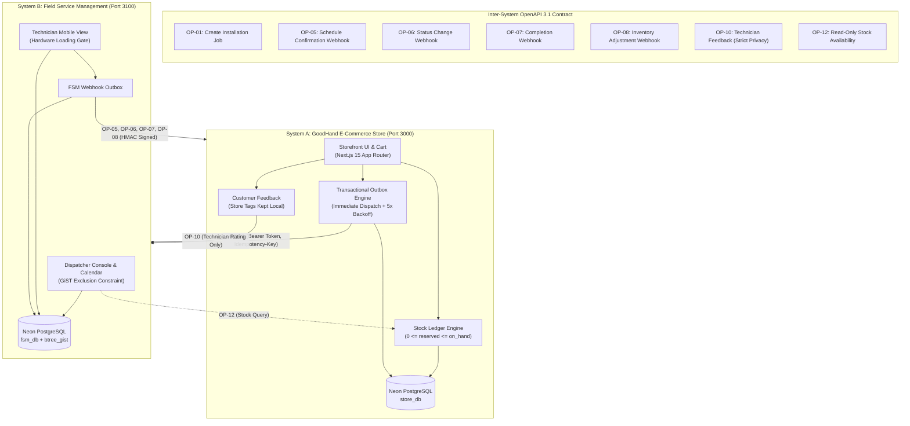

# GoodHand Security Store & Field Service Integration Prototype

> **Academic Integration Prototype Disclaimer:**  
> This software is an educational integration prototype built for demonstrating distributed architectures, transactional outbox patterns, and exclusion constraint scheduling. It is not an official commercial service of GoodHand Security Products. All brand names, trade marks, product specifications, and imagery are used strictly for educational evaluation under fair use.

---

## 1. System Architecture



---

## 2. Key Objectives & Verified Capabilities

- **OBJ-01 (100% Automated Job Creation):** When a customer purchases security equipment requiring installation, `OP-01` automatically provisions the corresponding job in System B via transactional outbox without human re-entry.
- **OBJ-02 (Zero Double-Booking):** System B prevents overlapping appointments using PostgreSQL GiST exclusion constraints (`EXCLUDE USING gist (technician_id WITH =, period WITH &&) WHERE (status = 'active')`).
- **OBJ-03 (Strict Stock Ledger & Loading Gate):**
  - Mathematical ledger enforcing $0 \le \text{reserved} \le \text{on\_hand}$ across all state transitions.
  - Technicians cannot click "Start Job" until 100% of required hardware items are confirmed loaded.
  - Completion report activates verified 12-month hardware warranties per serial number and adjusts warehouse inventory via unique `transactionId`s.
- **OBJ-04 (Privacy-Preserving Feedback Routing):**
  - Customer review form has two independent sections.
  - Only technician rating, technician tag chips, and customer first name are transmitted via `OP-10`.
  - Store rating, checkout tags, and customer contact details are strictly kept in System A.

---

## 3. Technology Stack & Workspace Structure

- **Monorepo:** pnpm 9 workspaces
- **Framework:** Next.js 15.5.29 (React 19, TypeScript 5.7, Tailwind CSS v4)
- **API Contract:** OpenAPI 3.1, Spectral, Zod validation
- **Database:** PostgreSQL (Neon serverless with `btree_gist`) + Drizzle ORM
- **Testing:** Vitest 3.2 (34 unit, contract, and interface tests)
- **Host OS:** Windows 10/11 (PowerShell scripts only, `.mjs` Node modules, no bash/WSL requirement)

```
SYSINT_GOODHAND/
├── apps/
│   ├── store/             # System A: E-Commerce Storefront (Port 3000)
│   └── fsm/               # System B: Field Service Management (Port 3100)
├── packages/
│   ├── contract/          # OpenAPI 3.1 YAML, Spectral rules, Zod schemas
│   ├── logger/            # Pino structured logger with PII auto-redaction
│   ├── ui-tokens/         # Design tokens extracted from GoodHand brand
│   └── ui/                # Shared UI components (StatusChip, Banner, Button)
├── docs/                  # Architectural documentation & specifications
│   ├── stock-ledger.md    # Mathematical ledger equations & proofs
│   ├── api-register.md    # Inter-system API register (OP-01 to OP-12)
│   ├── deployment.md      # Vercel & Neon multi-project deployment guide
│   ├── demo-script.md     # 7-minute presentation rehearsal script
│   ├── runbook.md         # Operations & failure-recovery runbook
│   ├── qa-checklist.md    # Manual QA matrix
│   └── constraints.md     # Vercel & runtime constraints
├── scripts/
│   ├── contract-check.mjs # 16/16 contract compliance validator
│   ├── clone-site.mjs     # Catalog crawler & vector SVG generator
│   └── reset-demo.mjs     # Demo baseline database restore script
└── .github/workflows/
    ├── ci.yml             # Lint, build & contract test pipeline
    └── drain.yml          # 5-minute outbox drain cron trigger
```

---

## 4. Getting Started (Windows PowerShell)

### Prerequisites
- Node.js 24+ installed (local SQLite uses the built-in `node:sqlite` module)
- pnpm 9 installed (`npm install -g pnpm@9`)
- Git

### 4.1 Clone & Install Dependencies
```powershell
git clone <repo-url> SYSINT_GOODHAND
cd SYSINT_GOODHAND
pnpm install
```

### 4.2 Configure Environment Variables
Copy `.env.example` to `.env`:
```powershell
Copy-Item .env.example .env
```
The apps use local SQLite databases at `.data/store.sqlite` and `.data/fsm.sqlite`.
Orders, jobs, stock, outboxes, accounts, sessions, feedback, and mail logs survive
restarts. See [local database setup](docs/local-database.md) for commands,
backups, and the separate hosted-database work required before Vercel deployment.

### 4.3 Run Contract Verification Check
Verify all 16 architectural contract clauses against `packages/contract/openapi.yaml`:
```powershell
node scripts/contract-check.mjs
```

### 4.4 Run Automated Test Suite
Execute the full Vitest suite:
```powershell
pnpm test
```

### 4.5 Start Both Applications Locally
```powershell
pnpm dev
```
- **System A Storefront:** `http://localhost:3000`
- **System A Presentation Panel:** `http://localhost:3000/demo`
- **System B Dispatcher Console:** `http://localhost:3100`
- **System B Technician Mobile App:** `http://localhost:3100/technician`
- **System B Presentation Panel:** `http://localhost:3100/demo`

---

## 5. Seed Accounts & Credentials (Development / Demo Mode)

| Application | Role | Email | Password | Scope / Capabilities |
|---|---|---|---|---|
| **System A** | Store Admin | `admin@goodhand88.com` | `AdminPassword123!` | Order management, refund review, outbox inspection |
| **System A** | Customer 1 | `customer1@example.com` | `CustomerPassword123!` | Purchasing, order tracking, review submission |
| **System A** | Customer 2 | `customer2@example.com` | `CustomerPassword123!` | Secondary customer profile |
| **System B** | Admin | `admin@fsm.local` | `FsmAdminPass123!` | Technician qualification & user administration |
| **System B** | Dispatcher 1 | `dispatcher1@fsm.local` | `DispatcherPass123!` | Job assignment, scheduling calendar, conflict resolution |
| **System B** | Dispatcher 2 | `dispatcher2@fsm.local` | `DispatcherPass123!` | Backup dispatcher |
| **System B** | Technician 1 | `arnel.mendoza@fsm.local` | `TechPassword123!` | Employee code: `TECH-001` (CCTV, Alarms, Locks) |
| **System B** | Technician 2 | `danilo.reyes@fsm.local` | `TechPassword123!` | Employee code: `TECH-002` (Fence, Networking) |

---

## 6. Demo & Presentation Features

Each application features an admin presentation panel (`/demo`) for live technical reviews:
- **Simulate Partner Outage:** Causes target system to immediately return `503 SERVICE_UNAVAILABLE` to demonstrate transactional outbox buffering and automatic retry backoff.
- **Force Payment Failure:** Tests checkout resilience and leaves orders in `pending_payment` with retry options.
- **Run Queue Now:** Triggers the outbox drain worker (guarded by a 6-second execution budget cutoff timer to protect against Vercel serverless ceilings).
- **Replay Message:** Replays failed messages while strictly preserving original idempotency keys.
- **Live Mail Log:** Real-time log of customer confirmations, technician assignments, and manager low-rating alerts.
- **Reset Demo Data:** Restores both applications to the clean initial seed state (`pnpm demo:reset`).

---

## 7. License & Compliance
This project is developed for educational evaluation purposes under academic fair use. All live site references comply with safe-harbor evaluation boundaries.
